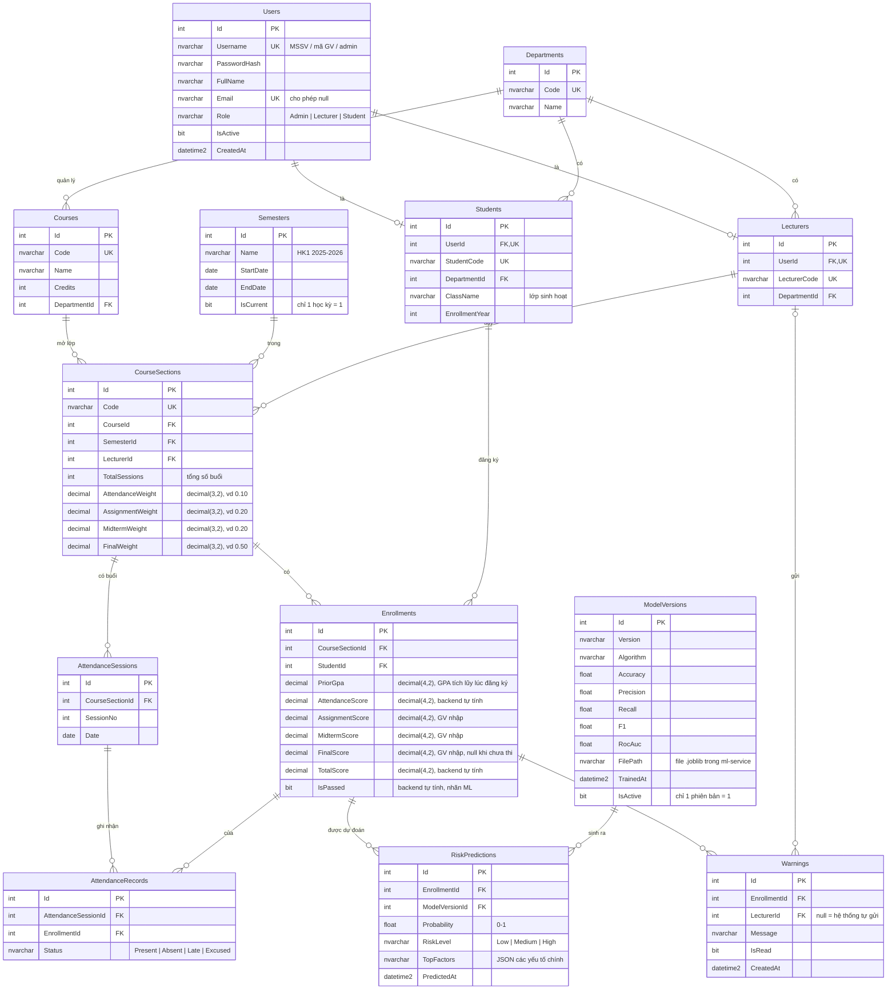

# ERD – Thiết kế cơ sở dữ liệu

Hệ quản trị: **SQL Server 2022**, tạo bảng bằng **EF Core Code First**.

## Sơ đồ

## Ràng buộc

| Bảng | Ràng buộc |
|---|---|
| `Users` | `Username` duy nhất; `Email` duy nhất khi khác null |
| `Students`, `Lecturers` | `UserId` duy nhất (quan hệ 1–1 với `Users`) |
| `Semesters` | Chỉ một dòng có `IsCurrent = 1` (unique filtered index) |
| `CourseSections` | Tổng 4 trọng số = 1; `TotalSessions > 0` |
| `Enrollments` | Cặp (`CourseSectionId`, `StudentId`) duy nhất; mọi cột điểm trong khoảng 0–10; `PriorGpa` trong khoảng 0–4 |
| `AttendanceSessions` | Cặp (`CourseSectionId`, `SessionNo`) duy nhất; `SessionNo` từ 1 đến `TotalSessions` |
| `AttendanceRecords` | Cặp (`AttendanceSessionId`, `EnrollmentId`) duy nhất |
| `ModelVersions` | Chỉ một dòng có `IsActive = 1` (unique filtered index) |
| `RiskPredictions` | `Probability` trong khoảng 0–1 |

## Quy tắc xóa (tránh lỗi multiple cascade paths của SQL Server)

SQL Server không cho phép một bảng bị xóa dây chuyền theo hai đường khác nhau, nên các khóa ngoại sau đặt **Restrict** (không cho xóa cha khi còn con):

| Khóa ngoại | Hành vi khi xóa cha | Lý do |
|---|---|---|
| `AttendanceRecords.EnrollmentId` | Restrict | Đã cascade qua `AttendanceSessions` |
| `Warnings.LecturerId` | Restrict | `Users` có 2 đường tới `Warnings` (qua `Lecturers` và qua `Students → Enrollments`), nên SQL Server không cho Set null. Giảng viên nghỉ thì khóa tài khoản (`Users.IsActive = 0`) thay vì xóa |
| `CourseSections.LecturerId` | Restrict | Không xóa giảng viên đang có lớp |
| `Students.DepartmentId`, `Lecturers.DepartmentId`, `Courses.DepartmentId` | Restrict | Không xóa khoa đang có dữ liệu |
| `CourseSections.CourseId`, `CourseSections.SemesterId` | Restrict | Không xóa môn/học kỳ đang có lớp |
| `RiskPredictions.ModelVersionId` | Restrict | Giữ lịch sử dự đoán |

Các khóa ngoại còn lại (`Enrollments → CourseSections`, `AttendanceSessions → CourseSections`, `AttendanceRecords → AttendanceSessions`, `RiskPredictions → Enrollments`, `Warnings → Enrollments`, `Students/Lecturers → Users`) dùng **Cascade**.

## Quy tắc tính điểm (backend tự tính, không nhập tay)

- **`AttendanceScore`** = 10 × (số buổi `Present` + 0.5 × số buổi `Late` + số buổi `Excused`) / `TotalSessions`. Tính lại mỗi khi lưu điểm danh.
- **`TotalScore`** = tổng (điểm thành phần × trọng số), làm tròn 1 chữ số thập phân. Chỉ tính khi đã có `FinalScore`.
- **`IsPassed`** = `TotalScore >= 4.0` **và** số buổi `Absent` ≤ 20% `TotalSessions` (vắng quá 20% bị cấm thi → rớt). Null khi chưa có `FinalScore`.

## Ghi chú thiết kế

- **Vai trò lưu thẳng trong `Users.Role`** thay vì bảng `Roles` riêng, vì hệ thống chỉ có 3 vai trò cố định.
- **Điểm lưu trong `Enrollments`** (một dòng = một SV trong một lớp học phần) thay vì bảng điểm riêng, giúp nhập điểm và truy vấn đơn giản.
- **Dữ liệu cho ML** lấy từ `Enrollments` + `AttendanceRecords`:
  - Đặc trưng: tỷ lệ vắng, `AttendanceScore`, `AssignmentScore`, `MidtermScore`, `PriorGpa`.
  - Nhãn huấn luyện: `IsPassed` của các học kỳ đã kết thúc.
  - **Không dùng GPA hiện tại của sinh viên** làm đặc trưng: GPA hiện tại đã bao gồm kết quả của chính môn cần dự đoán (rò rỉ dữ liệu – data leakage). Vì vậy GPA được chụp lại vào `Enrollments.PriorGpa` tại thời điểm đăng ký.
  - Không dùng `FinalScore`/`TotalScore` làm đặc trưng, vì lúc cần cảnh báo (giữa kỳ) chưa có các điểm này.
- **`RiskPredictions` giữ lịch sử** – mỗi lần dự đoán thêm một dòng, nên xem được rủi ro thay đổi theo thời gian.
- **Cảnh báo tự động**: khi dự đoán ra mức `High`, hệ thống tạo `Warnings` với `LecturerId = null`.
- **Làm thêm nếu kịp (tuần 8):** bảng `Assignments` và `Submissions` cho chức năng giao bài/nộp bài. Khi chưa có, giảng viên nhập thẳng `AssignmentScore`.
