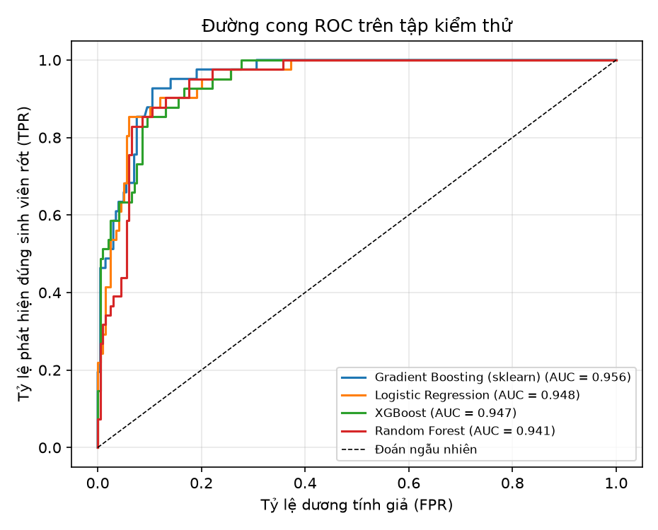
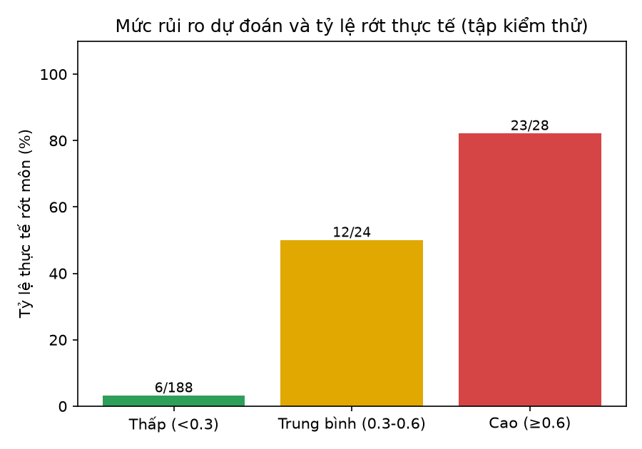
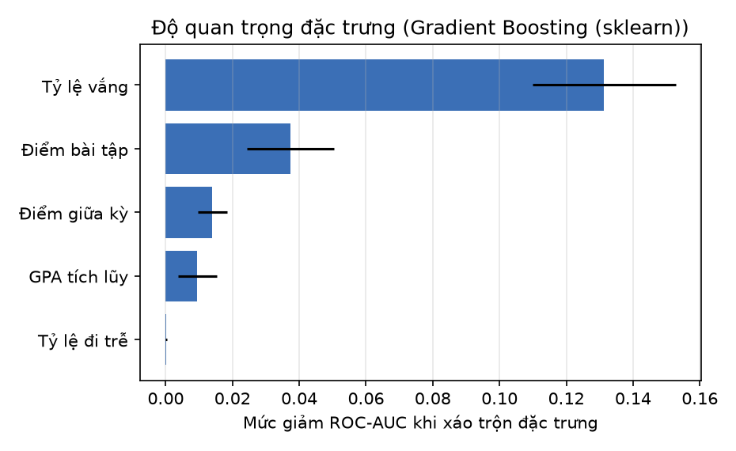

# So sánh các mô hình dự đoán nguy cơ rớt môn

> File này sinh tự động bằng `ml-service/experiments/compare_models.py`. Chạy lại khi dữ liệu thay đổi.

## Dữ liệu và cách đánh giá

- **Nguồn:** 1200 đăng ký môn đã có kết quả cuối kỳ (2 học kỳ) trong dữ liệu demo của hệ thống, trong đó **206 rớt (17.2%)**. Dữ liệu demo được **mô phỏng** (sinh viên thật không thể đưa vào đồ án) nhưng đi qua đúng các công thức tính điểm của hệ thống.
- **Bài toán:** dự đoán sớm sinh viên có rớt môn ở cuối kỳ hay không, dựa trên dữ liệu **chụp ở giữa kỳ** (nửa đầu số buổi). Lớp dương (cần phát hiện) là **rớt môn**.
- **5 đặc trưng:** tỷ lệ vắng, tỷ lệ đi trễ, điểm bài tập, điểm giữa kỳ, GPA tích lũy trước học kỳ. Không dùng điểm cuối kỳ (lúc cảnh báo chưa có) và không dùng GPA hiện tại (đã chứa kết quả môn đang dự đoán, gây rò rỉ dữ liệu).
- **Chia dữ liệu:** 80% huấn luyện (960 dòng) / 20% kiểm thử (240 dòng), chia phân tầng theo nhãn, cố định seed. Có thêm cross-validation 5 fold trên tập huấn luyện.
- **Dữ liệu thiếu:** mô phỏng thiếu ngẫu nhiên 8% điểm bài tập, 4% điểm giữa kỳ; sinh viên khóa mới tự nhiên thiếu GPA. Các mô hình đều xử lý được giá trị thiếu.
- **Mất cân bằng lớp:** dùng trọng số lớp (class_weight / scale_pos_weight) cho mọi thuật toán.
- **Ràng buộc đơn điệu:** các thuật toán dạng cây (Random Forest, Gradient Boosting, XGBoost) bị ràng buộc theo kiến thức nghiệp vụ: vắng và đi trễ càng nhiều thì xác suất rớt không giảm; điểm và GPA càng cao thì xác suất rớt không tăng. Nhờ vậy lời giải thích luôn hợp lý.
- Precision, Recall, F1 tính cho lớp "rớt" với ngưỡng 0.5.

## Kết quả (tập kiểm thử)

| Thuật toán | Accuracy | Precision | Recall | F1 | ROC-AUC | ROC-AUC (CV 5 fold) |
|---|---|---|---|---|---|---|
| Gradient Boosting (sklearn) | 0.896 | 0.633 | 0.927 | 0.752 | **0.956** | 0.957 ± 0.016 |
| Logistic Regression | 0.863 | 0.561 | 0.902 | 0.692 | **0.948** | 0.954 ± 0.014 |
| XGBoost | 0.871 | 0.581 | 0.878 | 0.699 | **0.947** | 0.954 ± 0.019 |
| Random Forest | 0.842 | 0.520 | 0.927 | 0.667 | **0.941** | 0.943 ± 0.021 |

Thuật toán có ROC-AUC cao nhất: **Gradient Boosting (sklearn)**. Logistic Regression và XGBoost chỉ dùng làm mốc so sánh. Chỉ Random Forest và Gradient Boosting (có ràng buộc đơn điệu, chạy được bằng scikit-learn nên image nhẹ) được phép triển khai.

## Mô hình triển khai: Gradient Boosting (sklearn) + hiệu chỉnh xác suất

Các mức rủi ro dựa trên xác suất (Thấp < 0.3, Trung bình 0.3–0.6, Cao ≥ 0.6) nên xác suất cần đáng tin. Mô hình được **hiệu chỉnh bằng Platt scaling** (sigmoid, 5 fold). Chỉ số trên tập kiểm thử sau hiệu chỉnh:

| Accuracy | Precision | Recall | F1 | ROC-AUC | Brier | Recall (ngưỡng 0.3 = Trung bình trở lên) |
|---|---|---|---|---|---|---|
| 0.900 | 0.730 | 0.658 | 0.692 | 0.956 | 0.063 | 0.854 |

Khi triển khai, mô hình được huấn luyện lại trên toàn bộ dữ liệu.

### Mức rủi ro dự đoán so với thực tế

| Mức rủi ro dự đoán | Số sinh viên | Số sinh viên thực sự rớt | Tỷ lệ rớt thực tế |
|---|---|---|---|
| Thấp (< 0.3) | 188 | 6 | 3.2% |
| Trung bình (0.3 – 0.6) | 24 | 12 | 50.0% |
| Cao (≥ 0.6) | 28 | 23 | 82.1% |

### Đặc trưng nào quan trọng nhất

| Đặc trưng | Mức giảm ROC-AUC khi xáo trộn |
|---|---|
| Tỷ lệ vắng | 0.131 ± 0.021 |
| Điểm bài tập | 0.037 ± 0.013 |
| Điểm giữa kỳ | 0.014 ± 0.004 |
| GPA tích lũy | 0.009 ± 0.006 |
| Tỷ lệ đi trễ | 0.000 ± 0.000 |

## Hạn chế cần nêu trong báo cáo

- Dữ liệu là dữ liệu **mô phỏng**, nên kết quả thể hiện khả năng của quy trình hơn là độ chính xác trên sinh viên thật. Khi có dữ liệu thật, chỉ cần huấn luyện lại (nút "Huấn luyện lại" của Admin).
- Điểm bài tập trong dữ liệu lịch sử là điểm cuối kỳ, được dùng làm xấp xỉ cho điểm bài tập ở giữa kỳ.
